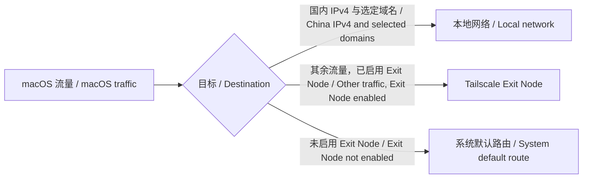

# tailscale-route

> macOS 菜单栏 Tailscale 分流工具：指定的国内 IPv4 地址和域名走本地网络，其余流量走已启用的 Tailscale Exit Node。

> A macOS menu bar utility for Tailscale split routing. Send selected China IPv4 destinations and domains through the local network while other traffic uses the configured Tailscale Exit Node.

[下载 DMG / Download DMG](https://github.com/I-Seer/tailscale-route/releases) · [MIT License](LICENSE)

## 快速开始 / Quick start

1. 下载最新 DMG，打开后将 `tailscale-route.app` 拖到“应用程序”文件夹。
2. 从“应用程序”启动 App；首次运行时按 macOS 提示批准特权 Helper。
3. 如需让其余流量经过 Tailscale，在 Tailscale 中先正常配置 Exit Node。

需要 macOS 13 或更高版本。DMG 为 Apple Silicon 与 Intel 提供通用二进制。App 管理本机路由；使用特权 Helper 时会请求 macOS 授权。它不会提供 Tailscale 服务，也不会改变任何第三方服务的账号资格或地区可用性，不能保证账号免于限制。请遵守相关服务的支持地区和使用条款；[Claude 支持地区政策](https://www.anthropic.com/legal/supported-regions)。本项目与 Anthropic、Tailscale 均无隶属关系。

当前预览 DMG 使用 ad-hoc 签名，尚未经过 Apple 公证。macOS 可能会显示开发者无法验证的提示；如果你不确定来源或不愿运行未公证的软件，请先不要打开。正式面向公众分发需要 Developer ID 签名和 Apple 公证。

The app manages local routes through a privileged Helper and requires macOS 13 or later. It does not provide Tailscale service, change eligibility for third-party services, or guarantee that an account will avoid restrictions. Use third-party services only in their supported regions and under their terms. This project is not affiliated with Anthropic or Tailscale.

The current preview DMG is ad-hoc signed and has not been notarized by Apple. macOS may show a warning that the developer cannot be verified. If you do not trust the source or are uncomfortable running unnotarized software, do not open it. Public distribution requires Developer ID signing and Apple notarization.

## 路由行为 / Routing behavior



指定域名的 A 记录走当前物理 IPv4 网关；AAAA 记录使用精确 IPv6 `/128` 主机路由走物理 IPv6 网关。添加根域名时会同时解析它和对应的 `www` 子域名。域名在 App 启动、增删域名、网络切换或唤醒后刷新，另有每 30 分钟兜底刷新；失败时以 30 秒起、最长 10 分钟退避重试。其余 IPv6 流量按系统默认路由转发；启用 Exit Node 时即经 Tailscale。

外接物理网段保护由 Helper 管理完整的直连 CIDR 路由。以 `192.168.32.0/20` 为例，Helper 使用外接接口本机地址（例如 `192.168.32.99`）创建 `/20` 的静态直连接口路由；macOS 路由表中会同时看到原生 `UCSI` 路由和项目管理的 `UCSc` 路由。

## 停止分流与退出

“停止分流”只由特权 Helper **按受管状态逐条精确删除中国 IP、手动 IP、域名和 Exit Node 端点分流路由**，并保留外接网卡保护；“恢复系统默认”和正常退出才会释放外接保护并在确认清理成功后恢复 Tailscale 原偏好。IPv4 所有权由目的网段、网关和接口共同确认；Exit Node 端点和域名 IPv6 主机路由各自有独立账本。物理默认路由、系统原生直连路由及 Tailscale 基础路由不会被项目的停止流程清理。

正常退出会先等待 Helper 完成清理，再注销 Helper 并退出 App；若清理失败，App 保持运行，失败项目保留在状态中，以便重试。App 被强制结束或崩溃时，无法保证执行清理。

强制退出后需要紧急恢复网络时，可双击项目根目录的 `recover-network.command`，或在终端运行 `scripts/recover-network.sh`。脚本通过已安装的 Helper 执行与退出 App 相同的清理（停止分流、释放外接网段保护路由、恢复本 App 改过的 Tailscale 偏好），精确清理本项目登记的路由及 `/etc/hosts` 域名钉住；不会清空整张路由表，也不会切换或删除 Tailscale 的基础路由。若 Helper 未运行，脚本会报错退出，不会改动系统网络。

对旧状态中未记录的 IPv4 路由，Helper 只会接管同时匹配当前目标清单、物理网关和接口的路由。其它无法证明归属的历史遗留路由不会被自动删除，应先通过诊断确认目的地、网关和接口，再逐条处理。

外接网段保护有一个明确的冲突例外：如果同一个外接 CIDR 在其它接口上存在带 IPv4 网关的静态路由（例如 `192.168.32.0/20 -> 192.168.1.1 en0`），Helper 会在写入外接物理路由前删除这条精确同前缀冲突路由。它只匹配静态、带网关、异接口的网络路由，不删除原生 `UCSI` 直连路由、项目目标接口上的 `UCSc` 路由或无法证明冲突的其它路由。

## 断网保护（Kill Switch）

默认关闭，在菜单栏“断网保护”卡片中开启。开启后，Helper 每 5 秒检查一次：Tailscale App/tailscaled 是否在运行、连接状态是否为 Running、Exit Node 是否在线，以及绑定 Tailscale 网卡（`IP_BOUND_IF`）向 1.1.1.1 / 8.8.8.8 / 9.9.9.9 的 443 端口发起 TCP 连接是否成功。

- **何时生效**：先确认过一次“经 Exit Node 上网正常”才开始保护，之后连续 3 次检查失败（约 15 秒）就触发拦截。没用过 Exit Node，或探测从未成功过，都不会拦截。
- **拦截什么**：通过 pf 锚点 `com.apple/250.TailscaleRouteKillSwitch` 拦截一切不经过 Tailscale 网卡的流量，包括国内分流、局域网、外接网卡网段和 DNS。只放行 Tailscale 重连所需的连接（各节点端点、DERP 中继、控制服务器），以及 DHCP 和 IPv6 邻居发现。不修改 `/etc/pf.conf`，也不禁用网卡。
- **何时解除**：Tailscale 恢复且外网探测连续 2 次通过；完全退出 Tailscale App；在 Tailscale 中取消 Exit Node；点击菜单栏的“手动解除断网保护”；退出 tailscale-route、运行 `recover-network.command` 或 `uninstall.sh`；重启 Mac。手动解除或退出 Tailscale 后，需要再次确认 Exit Node 正常，才会重新开始保护。
- **应急**：Helper 不可用时，`recover-network.command` 会用 `sudo pfctl -a com.apple/250.TailscaleRouteKillSwitch -F all` 清除规则。

## 永久保护的 IPv4 网段

目标清单会对中国 IP 源、固定 IP、手动 IP 和域名 A 记录统一应用不可覆盖的保护范围：RFC1918 私网 `10.0.0.0/8`、`172.16.0.0/12`、`192.168.0.0/16`，以及 Tailscale 使用的 CGNAT `100.64.0.0/10`。这些地址不会作为本 App 的分流目标；如果一个输入 CIDR 只部分落入保护范围，会拆分并仅保留范围外的部分。Tailscale 保护只覆盖 `100.64.0.0/10`，不会误排整个 `100.0.0.0/8`。

### Exit Node 端点保护

2026-10-13 新增：分流应用时自动从 `tailscale status --json` 的 `ExitNodeStatus` → peer → `CurAddr` 提取当前 Exit Node 的公网 IPv4 端点（例如 `198.18.45.40`），并做两层处理：

1. **清单保护**：端点 `/32` 与私网、CGNAT 同级，从中国清单、固定 IP、手动 IP 和域名 A 记录中扣除（部分重叠 CIDR 自动拆分）；路由协调器还会再次过滤，防止绕过清单生成器的调用方把它加回目标。没有端点保护前，一旦路由查找命中 utun 全局默认，隧道 UDP 可能成环。
2. **主机路由兜底**：Helper 维护 `端点IP/32 via 当前物理网关` 的精确主机路由（记录在 `managedExitNodeEndpointRoutes`，与分流目标分开归属）。Tailscale 正常靠 socket 绑定物理接口避免回环；这条路由保证即使绑定失效，端点仍可达，且网络切换后随网关更新。纯 DERP 中继（CurAddr 为空）、IPv6 端点和局域网私网端点（同网段直连，无需钉路由）自动跳过。

停止分流时，Exit Node 端点主机路由作为项目受管路由精确删除；下一次启用分流时重新建立。

因此，解析到 Exit Node 端点 IP 的域名（例如 `example.net` → `198.18.45.40`）不会作为普通域名目标下发，而是随这条端点主机路由一起走物理网关。

### 域名解析 DNS 服务器钉住

2026-11-17 新增：临时域名用 `dig @114.114.114.114` / `dig @222.85.85.85` 解析，但 `@服务器` 只决定“问谁”，不决定从哪个网卡发出；启用 Exit Node 时默认路由是 utun，查询会进隧道并超时。旧实现依赖中国清单路由恰好覆盖这两个地址，而首次应用时清单路由尚未下发（域名在建清单阶段就要解析），仅刷新域名的路径也不会碰清单路由。

现在 Helper 在**每次解析前**（应用分流和按需的域名刷新）先为这两个地址维护 `/32 via 当前物理网关` 的精确主机路由，记录在 `managedDNSServerRoutes`，与分流目标和 Exit Node 端点分开归属，写入后立即持久化账本。网关和接口取自当次网络快照，所以从 Wi-Fi 切到外接网卡（或反过来）时，旧网卡上的钉住路由按三元组精确删除，再在新网卡上重建并用 `route get` 验证。删除未确认的旧路由会保留在账本中等待重试。停止分流时精确删除；菜单栏“域名解析 DNS”一行显示当前钉在哪个接口。

### DNS 与连通性排查

本 App 管理分流路由、自己写入 `/etc/hosts` 的标记段，以及外接网段发生路由冲突时的 Tailscale 子网路由接收偏好；它不会修改 macOS 或 Tailscale 的系统 DNS，也不会关闭 Tailscale Exit Node。网页无法访问时，可分别检查 DNS 解析、IPv4/IPv6 连通性和 Exit Node 状态。使用 Exit Node 时，DNS 解析器的选择还受 Tailscale 设置影响，详见 [Tailscale DNS 文档](https://tailscale.com/docs/reference/dns-in-tailscale#nameservers-and-exit-nodes)。临时域名功能使用配置的 DNS 服务器，查询从哪个接口发出仍由当前路由决定。退出本 App 只移除本 App 登记的分流路由，不会切换 Tailscale 的 Exit Node。

路由协调器还会再次执行保护过滤，防止其他调用方绕过目标清单生成器。清理旧版 App 路由时，Helper 使用已保存的目的网段、网关和接口三元组确认所有权；不会因目的网段相同而删除另一网关或 Tailscale 接口上的路由。用户配置的排除 CIDR 也按地址范围精确扣除，不会因局部重叠而丢掉候选网段中其余部分。

### 物理直连私网保护

界面只显示状态，不再要求用户输入或维护 CIDR。Helper 自动识别活跃的外接物理以太网/Wi-Fi 接口，从接口地址和连续子网掩码计算直连 CIDR，并要求内核路由表中存在同接口、同前缀的直连路由。接口插拔、地址改变、睡眠唤醒和定时刷新都会重新发现。

发现的直连 CIDR 会从本 App 的目标清单中动态扣除。Helper 同时确保完整 CIDR 的项目管理路由指向外接物理接口，并对网段内可用首尾地址、中点、接口本机地址执行 `route get` 验证；不使用网络地址或广播地址作为探针。若 Tailscale 接收的子网路由抢占本地直连网段，Helper 会保存原偏好并自动设置 `--accept-routes=false`；使用 Exit Node 时会临时打开 `--exit-node-allow-lan-access`，Exit Node 默认路由保持连接。拔出外接网卡、退出 App、运行恢复脚本或卸载脚本时，只要当前 Tailscale 登录身份（优先按 `debug prefs` 中的 NodeID 判断，切换或关闭 Exit Node 不再阻止恢复）和偏好仍符合本 App 写入的状态，就自动恢复原偏好。`/etc/hosts` 钉住不会写入 `tailscale.com`、`ts.net` 等 Tailscale 自身域名。

`accept-routes=false` 会暂时关闭本客户端的**全部** Tailscale 子网路由接收，这是为消除重叠路由冲突而自动采取的策略；状态卡会明确显示这一影响。该流程不修改网卡地址/掩码，也不增删、拆分或重建原生 `UCSI` 直连路由；项目只额外维护一个完整 CIDR 的 `UCSc` 静态接口路由，不创建 `/21`、`/22` 等派生保护路由。升级时会清除旧版拆分账本和重复缓存，不把它们重新纳入当前状态。

### 性能

状态读取走原生系统接口：IPv4 路由表用 `sysctl(NET_RT_DUMP2)`，网卡、网关和外接判断用 `getifaddrs`/`ioctl`、SystemConfiguration 与 IOKit，不再为每次刷新启动 netstat、ifconfig、networksetup、ipconfig、ioreg 子进程；任一原生读取失败时自动回退原命令。Tailscale `status --json` 与 `debug prefs` 合并在一次用户会话中读取并短暂缓存 2 秒，写入偏好后立即失效。

### 主要实现


| 文件 | 职责 |
| --- | --- |
| `Sources/TailscaleRouteApp/TailscaleRouteApp.swift` | 菜单栏界面状态、网络变化监控、Helper 生命周期和退出流程 |
| `Sources/TailscaleRouteCore/HelperService.swift` | Helper 请求分发、路由应用/停止、状态持久化 |
| `Sources/TailscaleRouteCore/ExternalGatewayRouteProtector.swift` | 管理完整外接 CIDR、清理同前缀静态网关冲突、验证物理接口出口 |
| `Sources/TailscaleRouteApp/HelperInstaller.swift` | 通过 `SMAppService` 严格注销、等待、注册 Helper，拒绝复用旧进程 |
| `Sources/TailscaleRouteCore/RouteManager.swift` | IPv4 分阶段路由事务、精确所有权匹配、只读计划与读回验证 |
| `Sources/TailscaleRouteCore/ExternalDirectNetworkDetector.swift` | 外接接口、IPv4 地址/掩码与内核直连路由的只读发现 |
| `Sources/TailscaleRouteCore/TargetListBuilder.swift` | 合并并过滤 IPv4 目标、解析临时域名 A/AAAA、生成目标清单 |
| `Sources/TailscaleRouteCore/DomainResolver.swift` | 通过配置的直连 DNS 解析临时域名；查询失败时不使用系统 DNS 结果 |
| `Sources/TailscaleRouteCore/HostsPinManager.swift` | 原子更新 `/etc/hosts` 中本项目独立标记的域名段 |
| `Sources/TailscaleRouteCore/Storage.swift` | 原子保存配置、带 generation/fingerprint 的状态、事务快照和日志 |

### 停止流程

- “停止分流”“恢复系统默认”和正常退出都只处理 Helper 账本中的本项目路由；
- IPv4 路由必须匹配目的网段、网关和接口，域名 IPv6 与 Exit Node 端点按各自的精确状态清理；
- 清理失败时保留失败类别的受管记录，App 显示错误并保持运行，用户可以重试；
- 当前 Helper 协议版本为 61。App 检测到不同版本时会严格注销旧 Helper，等待服务注销完成，再注册随 App 打包的新 Helper；注销或注册失败不会继续使用旧进程。

### 完成后的验证与安装

```sh
swift test                    # 运行单元测试
scripts/build.sh              # 重建 dist
scripts/install.sh            # 安装并打开 App；App 自动重载 Helper
```

不要用 `launchctl submit` 手工启动 Helper，也不要把 `launchctl kickstart` 当作升级流程。正常生命周期由 App 的 `SMAppService.daemon("com.tailscale-route.helper.plist")` 管理；升级时 App 会注销旧服务、等待注销状态完成、注册新服务并等待服务状态恢复。需要彻底卸载时运行 `scripts/uninstall.sh`；它会停止系统服务并删除 App，但默认保留用户配置和日志。

安装后核对：`shasum /Applications/tailscale-route.app/Contents/MacOS/tailscale-route-helper dist/tailscale-route.app/Contents/MacOS/tailscale-route-helper` 两个哈希一致；App 检测到旧 Helper 会自动注销重装。

安装后检查：菜单“退出”或 `⌘Q` 后，确认 App 与 `com.tailscale-route.helper` 均停止；日志应显示受管路由的精确清理结果。停止前后检查系统默认路由和 Tailscale Exit Node 路由仍存在，并确认只删除了登记的目标路由。

## 现在能做什么

- 读取物理默认网关、网络接口、Tailscale 状态、Exit Node 和当前路由表；
- 生成网络指纹，并在 Wi‑Fi、网线或热点变化后自动重建路由；
- 合并中国 IPv4 CIDR 源、固定 IP、手动 IP、域名解析结果和排除 CIDR；永久跳过 RFC1918 私网及 Tailscale `100.64.0.0/10`，局部重叠的 CIDR 只剔除命中部分；
- 在 App 中临时添加或移除根域名，自动一并解析对应 `www` 主机名，立即更新 A/AAAA 本地网关路由；App 启动、网络切换或唤醒后以及每 30 分钟兜底重新解析，域名列表保存在本机配置中，可随时移除；
- 临时域名使用的解析 DNS 可在“自动化与工具 › 高级设置”中配置（IPv4，最多 4 个，默认 `114.114.114.114`、`222.85.85.85`）；每个地址都会被钉到当前物理网关，修改后立即重新解析；
- “一键测试”同时刷新分流状态并做分层连通性检查（TCP、可选 HTTP 及路由解释）；测试地址、端口和 URL 在“高级设置”中配置，默认 `1.1.1.1:443`；
- 自动显示外接网卡的 IPv4 地址和原生直连 CIDR；冲突时自动协调 Tailscale 子网路由接收设置并验证实际出口，不改网卡或原生路由；
- 对远程清单记录来源、时间、源哈希、条目数量和格式版本；校验失败或下载失败时原子回退到保留的 last-known-good JSON 缓存；目标清单另有 SHA-256；
- 通过权限 Helper 执行真实路由操作，App 本身不执行 `sudo` 或拼接 shell 命令；
- 网关变化时先分阶段更新并验证新路由，再清理精确匹配账本的旧路由；部分失败保留已确认路由与待重试账本；
- 用 Unix socket、文件锁和原子写入避免 Helper 与手动操作并发或留下半套状态；
- 菜单栏 Dashboard 提供状态总览、网络详情、路由统计、计划预览、路由解释、分层连通性、开始/更新/停止、自动跟随网络、清单更新和日志入口；
- 停止分流前会弹出明确确认；停止、恢复默认和正常退出只清理本项目登记的路由，并保留物理网络和 Tailscale 基础路由。

无法证明归属的历史路由不会被自动删除。诊断后应按目的地、网关和接口逐条核对，避免影响其它 VPN、物理网络或 Tailscale。

## 项目结构

```text
Package.swift                         Swift Package 定义
Sources/TailscaleRouteApp/            SwiftUI 菜单栏 App
Sources/TailscaleRouteCore/           网络检测、清单、路由、状态和 Helper 协议
Sources/TailscaleRouteDiagnose/       只读诊断命令
Sources/TailscaleRouteCLI/            内存路由事务模拟器
Sources/TailscaleRouteHelper/         受保护的权限 Helper
Sources/RouteSocket/                  Unix socket C 接口
Tests/                                单元测试和清单 fixture
Resources/                            App 与 LaunchDaemon plist
scripts/                              构建、安装、卸载脚本
```

## 开发与验证

在项目根目录执行：

```sh
# 单元测试
swift test

# 只读诊断，不修改系统路由
swift run tailscale-route-diagnose
swift run tailscale-route-diagnose --json
swift run tailscale-route-diagnose --explain 8.8.8.8

# 分层连通性：会检查 route/ARP/ICMP；指定的 TCP/HTTP 项会建立连接
swift run tailscale-route-diagnose --connectivity 1.1.1.1 --tcp-port 443 --http https://example.com

# 内存模拟网关切换和部分失败保留，不修改真实路由
swift run tailscale-route-cli \
  --desired Tests/Fixtures/desired.cidrs \
  --old-gateway 192.168.1.1 \
  --gateway 172.20.10.1
swift run tailscale-route-cli \
  --desired Tests/Fixtures/desired.cidrs \
  --fail-target 2.0.0.0/8

# 只读采集当前路由快照，并在内存后端测量 2000 条目标
swift run tailscale-route-cli --benchmark --benchmark-targets 2000

# 直接启动 SwiftUI App；修改路由仍需要 Helper
swift run tailscale-route
```

诊断命令支持 `--desired /path/to/desired.cidrs`。清单是一行一个 IPv4 地址或 CIDR，空行和 `#` 注释会被忽略。

`tailscale-route-cli --live-replace` 会通过已安装 Helper 修改真实系统路由，属于高风险操作；除非明确需要，不要使用该选项。

## 构建、安装与卸载

生成 Apple Silicon 与 Intel 通用 DMG：

```sh
scripts/package-dmg.sh
```

产物为 `dist/tailscale-route-<版本>-universal.dmg`。默认使用 ad-hoc 签名且未公证；准备好 Developer ID 和 `notarytool` 钥匙串配置后，可提供 `CODESIGN_IDENTITY` 与 `NOTARY_PROFILE` 执行正式签名和公证：

```sh
CODESIGN_IDENTITY="Developer ID Application: ..." NOTARY_PROFILE="notary-profile" scripts/package-dmg.sh
```

生成经过 ad-hoc 签名的本地 App：

```sh
scripts/build.sh
```

产物为 `dist/tailscale-route.app`。生产签名可提供 `CODESIGN_IDENTITY`：

```sh
CODESIGN_IDENTITY="Developer ID Application: ..." scripts/build.sh
```

安装和卸载：

```sh
scripts/install.sh
scripts/uninstall.sh
```

如果 `/Applications` 或系统服务目录需要管理员授权，macOS 会在执行相应步骤时提示授权；不要用 `sudo` 启动 App 本身。

安装后 App 使用 `SMAppService` 注册 `com.tailscale-route.helper`。Helper 由 launchd 以 `system/com.tailscale-route.helper` 运行，负责所有需要权限的路由读写；App 与它通过 `/var/run/tailscale-route-helper.sock` 或用户态 socket 通信。卸载默认不删除用户配置和日志。

### 发布公开副本

`docs/`（内部方案与排查记录）、`CLAUDE.md`、`AGENTS.md` 只供本地开发使用。发布前用导出脚本生成一份不含 git 历史的干净副本：

```sh
scripts/export-public.sh ~/tailscale-route-public
```

脚本会排除上述文件、构建产物和日志，并扫描导出结果。如果项目根目录有 `.private-patterns`（本地私有关键字清单，每行一个，已被 `.gitignore` 忽略且不会导出），命中任意关键字即报错。用户配置（域名列表、DNS、测试目标等）保存在 `~/Library/Application Support/tailscale-route` 和 `/Library/Application Support/tailscale-route`，不在仓库中。

### 彻底清理后重新安装

以下操作会删除域名列表、清单缓存、状态账本和日志。只有需要重新配置时才执行：

```sh
scripts/uninstall.sh
rm -rf "$HOME/Library/Application Support/tailscale-route"
sudo rm -rf "/Library/Application Support/tailscale-route"
scripts/build.sh
scripts/install.sh
```

重新安装后，先确认 Helper 已由 App 启动，再重新添加域名；不要手动启动一个临时 Helper 代替系统服务。

## 状态与日志

用户侧设置和只读缓存位于：

```text
~/Library/Application Support/tailscale-route/
```

权限 Helper 的状态、清单、锁和日志位于：

```text
/Library/Application Support/tailscale-route/
```

主要文件包括 `config.json`、保留的 `china-cache.json`、`desired.cidrs`、`last-success.json`、`pre-apply-routes.json`、`post-apply-routes.json`、`last-operation.json`、`route.lock` 和 `logs/tailscale-route.log`。旧版 `china.cidrs`、`china.source`、`manual.ips`、`exclude.cidrs`、`domain.ips` 和 `domain.ipv6` 仅是重复/降级缓存，升级时会清除；域名配置仍保存在 `config.json`。状态文件包含 schema/generation 和账本指纹；路由表始终视为可重建结果，内核快照仍是当前事实来源。

## 运行前提

- macOS 13 或更高版本；
- 已安装并运行 Tailscale CLI；
- 已配置可用的 Tailscale Exit Node；
- Exit Node 需要允许 LAN access，否则本地网关探测或验证可能失败；
- 修改路由需要安装并运行权限 Helper；
- 中国 IPv4 清单默认来自 `17mon/china_ip_list`，更新失败时会在缓存可用的情况下回退到本地缓存。

## 安全边界

- App 和 CLI 默认只读或使用内存模拟；
- 真实路由修改只由权限 Helper 执行；普通 IPv4 分流批处理通过 PF_ROUTE socket，暂停/停止按账本精确删除；Exit Node 端点和域名 IPv6 路由由 Helper 使用 `/sbin/route` 操作；外接网段保护读取网卡/路由信息、协调 Tailscale 偏好，并维护完整 CIDR 的静态物理接口路由；
- 用户输入不会被拼接进 shell 命令；
- 路由应用前会保存只读快照，应用过程中使用锁、进度和验证；
- `停止分流`、恢复默认及正常退出只删除能通过所有权检查的项目路由；物理网络和 Tailscale 基础路由保持不变。
